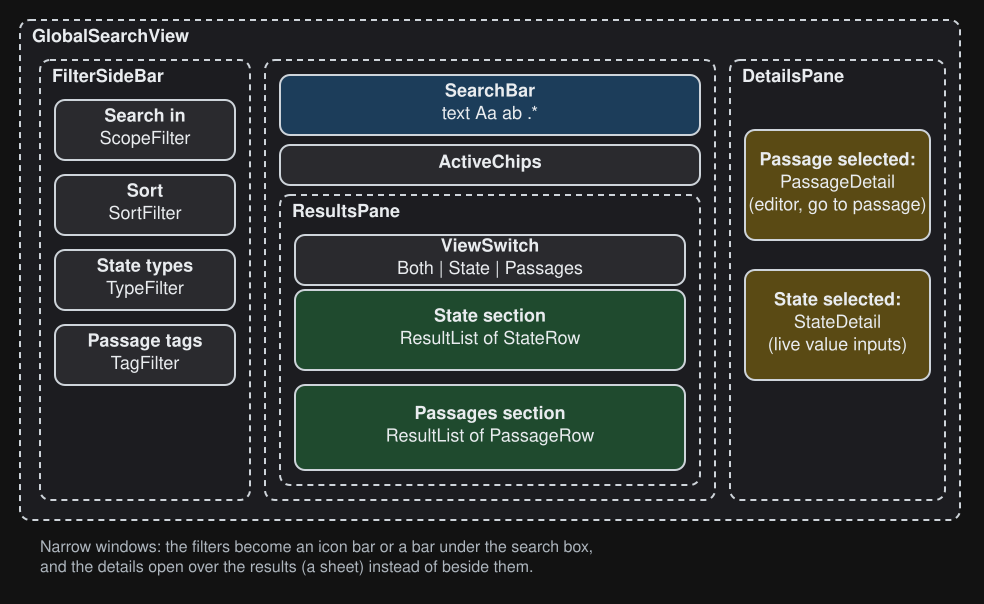
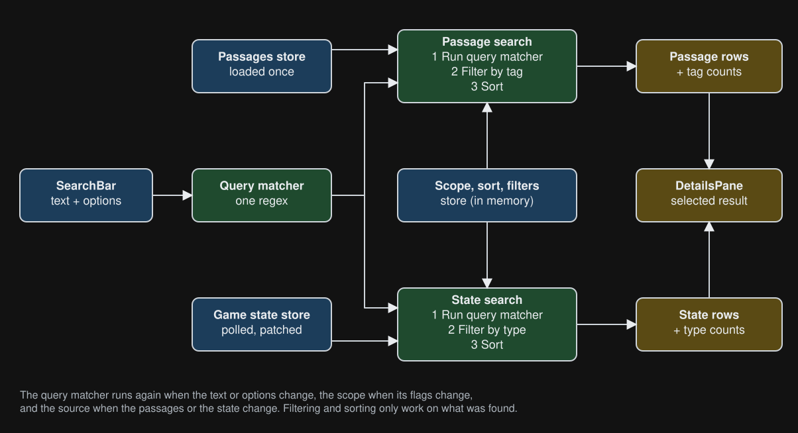

# Search

The Search page finds text in the game's **state** (paths and values) and in its **passages**
(name, tags, content) at the same time, and shows both result lists next to a preview of the
selected result. This document explains what it does, which parts it is made of, where the data
comes from and how it flows. [`design-notes.md`](./design-notes.md) explains why it is built the way
it is, which is worth reading before changing anything that touches speed.

All code is in `src/devtools-panel/views/GlobalSearch/`. The route (`pages/SearchPage.tsx`) only
renders `GlobalSearchView`.

## What it does

- **Search text** with three options: match case, whole word, regular expression. A regular
  expression that is not valid shows its error under the box and finds nothing.
- **What is searched in**: for the state its path and/or value, for passages their name, tags and/or
  content. A part that is switched off finds nothing.
- **Two result lists**, State and Passages, with a switch to show both or only one. When both are
  shown, a section can be folded away. Each list says how many are shown of how many were found.
- **Sort**: state by source order, path, type or recently changed; passages by best match (name and
  tags first), most matches or name.
- **Filter**: state by value type, passages by tag (any of the chosen tags). The filter groups show
  how many of what was found has each type or tag. Whatever is not how it starts out is shown as a
  chip that takes it away again.
- **Highlighted matches** in the rows and in the editor of the selected passage (the editor also
  scrolls to the first match).
- **Details of the selected result**: a passage opens in the editor (with a button to go to it in
  the game and one to open it on the Passages page); a state value shows the live input for its
  type (strings, numbers and booleans) and a button to show it in the State view. Clicking the selected result again closes it.
- **Ctrl+Shift+F** from anywhere in the panel opens the page and focuses the search box.
- **The layout follows the width of the window**, because DevTools can be docked next to the game.

## What is on the screen



(Source: [`layout.excalidraw`](./diagrams/layout.excalidraw).)

| Component                       | Job                                                                                                                                         |
| ------------------------------- | ------------------------------------------------------------------------------------------------------------------------------------------- |
| `GlobalSearchView`              | Owns the query matcher and the selected result, creates the two searches and passes data down as props                                      |
| `SearchBar`                     | The text box and the three option toggles. Makes the query matcher from them and reports why it can't                                       |
| `FilterSideBar`, `FilterTopBar` | The four filter groups (what is searched in, sort, state types, passage tags), as a full sidebar, an icon bar or a bar under the search box |
| `ActiveChips`                   | What is not how it starts out, each with a button to take it away                                                                           |
| `ResultsPane`                   | `ViewSwitch` plus one `ResultSection` per list; each holds a `ResultList`                                                                   |
| `ResultList`                    | A virtualized list: only the rows in view exist. Rows are `PassageRow` and `StateRow`                                                       |
| `DetailsPane`                   | The selected result, as a column beside the results or as a sheet over them. `PassageDetail` or `StateDetail`                               |

The page is laid out by the width of the **window** (`utils/create-get-breakpoint.ts`):

| Window width      | Filters                                                                      | Details                   |
| ----------------- | ---------------------------------------------------------------------------- | ------------------------- |
| below 760 px      | an icon bar or a bar under the search box (setting, with a button to switch) | sheet over the results    |
| 760 to 1120 px    | full sidebar                                                                 | sheet over the results    |
| 1120 px and wider | full sidebar                                                                 | column beside the results |

## Where the data comes from

| Data                                 | Lives in                                                                           | Changes when                                                                                               |
| ------------------------------------ | ---------------------------------------------------------------------------------- | ---------------------------------------------------------------------------------------------------------- |
| Game state                           | `store/game-state.ts` (`getLatestState`, `getLatestId`, `getLastChangeIdByKey`)    | The panel polls the content script and patches the state with the deltas; the id goes up with every change |
| Passages                             | `store/passages.ts` (`getPassageData`)                                             | Loaded once; again after a reload or a save                                                                |
| Search text and options              | `store-helpers/search-input.ts` (module signals)                                   | The user types or toggles an option, in `SearchBar`                                                        |
| Scope, sort, type filter, tag filter | `store.viewState.search`, read and written through `store-helpers/search-state.ts` | The user changes a filter                                                                                  |
| Settings that matter here            | `store.settings`: `search.*` and `editor.disableHighlighting`                      | Settings page, or the layout button of the narrow layouts                                                  |
| Selected result                      | A signal in `GlobalSearchView`                                                     | The user clicks a row                                                                                      |

## How the data flows



(Source: [`data-flow.excalidraw`](./diagrams/data-flow.excalidraw).)

1. **Typing** in `SearchBar` does not search straight away. The text is committed when the browser
   is idle (`whenIdle`, at most 50 ms later), and keys typed in the meantime are one commit.
2. `SearchBar` makes the **query matcher** (`logic/query-matcher.ts`) from the text and the options.
   This is one regular expression that can find a match, give positions for highlighting and count.
   It is `null` when there is nothing to search for or the expression is not valid, and then nothing
   is found.
3. **`createPassageSearch`** and **`createStateSearch`** (`store-helpers/`) each run the same three
   steps on their own data:
   1. _find_: the matches in the passages, or in the keys and primitive values of the state
      (`logic/passage-search.ts`, `logic/state-search.ts`). When the new search text is a longer
      version of the previous one, the passage search only goes through the previous hits
      (_narrowing_, see the design notes);
   2. _filter_: the chosen tags, or the chosen types;
   3. _sort_: the chosen order (`logic/sort.ts`).
4. Each returns the sorted hits, how many were found before filtering, and the counts that the filter
   groups show (tags, types).
5. `ResultList` shows the sorted hits. A hit is plain data: where the text was found in a passage or
   state entry. The rows look up what else they show (the name, tags and content of the passage)
   from the passages.
6. Clicking a row sets the **selected result**. `DetailsPane` shows it.

Each step only runs when its own inputs change:

| What changes                | What runs again                                           |
| --------------------------- | --------------------------------------------------------- |
| Search text or options      | Find, filter and sort, for both lists                     |
| Scope                       | Find and what follows, for the list that scope belongs to |
| Passages (a save or reload) | Passage search                                            |
| Game state                  | State search (when there is a query)                      |
| A filter                    | Filter and sort                                           |
| The sort order              | Sort                                                      |

## What is remembered

| What                                                | Where                              | Survives                                                                                |
| --------------------------------------------------- | ---------------------------------- | --------------------------------------------------------------------------------------- |
| Search text                                         | module signal                      | Visiting another page. Never saved                                                      |
| Match case, whole word, regex                       | module signal                      | Visiting another page; a restart when "Remember match case, whole word and regex" is on |
| What is searched in, sort order, state type filter  | `store.viewState.search`           | Visiting another page; a restart when its "Remember …" setting is on                    |
| Passage tag filter                                  | `store.viewState.search`           | Visiting another page. Never saved: which tags are useful depends on the game           |
| Which of the views (both, state, passages) is shown | module signal in `results-view.ts` | Visiting another page                                                                   |
| Selected result, folded sections                    | component state                    | Nothing: reset when the page is left                                                    |
| Where the filters go in a narrow window             | setting `search.smFilterLayout`    | A restart                                                                               |

The "Remember …" settings are `search.persist.*`, and the saved values are `search.saved.*`. Both
are in `store.settings`, which is kept in `localStorage`. `createSearchPersistence()` (called by
`GlobalSearchView`) keeps the saved values up to date while the setting is on.

## Where the code is

```
views/GlobalSearch/
  GlobalSearchView.tsx    the page: wires everything together
  types.ts                the types of the feature (matcher, hits, scopes, sorts, selected result)
  logic/                  plain TypeScript, no Solid: query matcher, passage and state search, state
                          walk, sort. Unit-tested in node
  store-helpers/          Solid code that reads or writes the stores
    create-passage-search.ts, create-state-search.ts   find, filter, sort and counts
    search-state.ts       scope, sort and filters in the store, their counts, persistence
    search-input.ts       search text and options
    search-focus.ts       the request to focus the search box (Ctrl+Shift+F)
  subcomponents/          the components listed above
    SearchBar/            the search bar, its option toggles and the idle commit
    Filters/              the filter groups and the three ways to lay them out
  utils/search-defaults.ts   the starting values of scope, sort and options
```

## Words used here

- **Query matcher**: what the search text and options are turned into. Finds matches in a text.
- **Hit** (`PassageMatcherHit`, `StateMatcherHit`): where the query matcher found something in one
  passage or one state entry. Not the passage itself: just its key and the positions.
- **Found**: what the search finds before filtering. The totals and the counts are about this.
- **Scope**: which parts are searched (state path, state value, passage name, tags, content).
- **Narrowing**: searching only the hits of the previous search, because the new search is a longer
  version of it. See the design notes.
